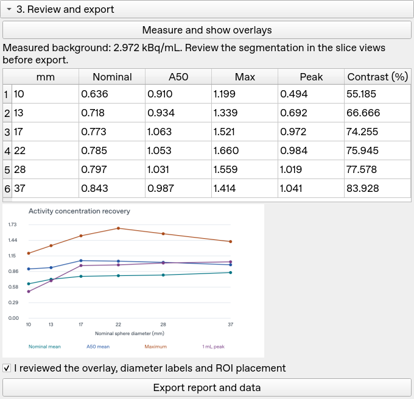
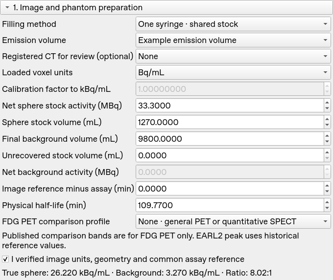

<p align="center">
  
</p>

# PET Analyzer for 3D Slicer

Measure how well reconstructed PET or calibrated SPECT images recover the known activity in the six hot spheres of an IEC/NEMA body phantom. PET Analyzer calculates reference concentrations from one- or two-syringe preparations, locates sphere centers, and exports recovery curves and measurements for research and scanner QA.



*Results from a measured fluorine-18 fluoride phantom. FDG comparison bands are disabled for this scan.*

## Install from GitHub

1. [Download the source ZIP](https://github.com/HarlleyHauradou/SlicerPETAnalyzer/archive/refs/heads/main.zip) and extract it to a permanent folder. Git users can instead run:

   ```sh
   git clone https://github.com/HarlleyHauradou/SlicerPETAnalyzer.git
   ```

2. In [3D Slicer](https://download.slicer.org/), open **Edit → Application Settings → Modules**.
3. Under **Additional module paths**, add the extracted **`PETAnalyzer`** folder that contains **`PETAnalyzer.py`**. For the ZIP, this is usually `SlicerPETAnalyzer-main/PETAnalyzer`.
4. Click **OK**, restart Slicer, and open **Quantification → PET Analyzer** from the module selector.

Source installation was tested in **3D Slicer 5.10.0 on Linux**. The module uses the NumPy and SciPy packages bundled with Slicer.

## Analyze a phantom

### 1. Load the image and enter the filling data

Import the reconstructed emission series with Slicer's **DICOM** module, then select it as the **Emission volume**. Select an already registered CT if you want to review the overlays against anatomy. Confirm the voxel units, image geometry, and decay reference. For units other than Bq/mL or kBq/mL, supply a validated conversion factor to kBq/mL.

| Filling method | Values to enter |
| --- | --- |
| **One syringe · shared stock** | Net activity and final volume of the sphere stock, final background volume, and any stock volume that did not enter either compartment. The module subtracts 47.838 mL for the six nominal spheres. |
| **Two syringes · separate solutions** | Net sphere stock activity and dilution volume, plus net background activity and final background volume. Bring both assays to a common reference time before entry. |

Enter the physical half-life and the interval between the common assay reference and the image reference. For example, 33.3 MBq in 1,270 mL with no unrecovered stock, a 9,800 mL final background, and zero decay delay gives **26.2205 kBq/mL** in the spheres and **3.2700 kBq/mL** in the background.



### 2. Locate spheres and reference regions

- Set the sphere plane to the native emission slice near the sphere centers, then click **Detect six sphere centers**. Review all six diameter labels in the slice views. If detection needs correction, edit the points in **Markups** or create a manual list in ascending order from **10 to 37 mm**.
- Place one background point in homogeneous liquid. Adjust the VOI radius so it clears the phantom wall, hot spheres, and lung insert. For lung residual, place a separate point inside the lung insert.
- For planar contrast and background variability, optionally place 12 well-spaced background points in the sphere plane. Each must accommodate a 37 mm circle. The module samples these locations on the native slices nearest 0, ±10, and ±20 mm.

### 3. Review and export

Click **Measure and show overlays**. Check the VOIs and per-sphere results, confirm the review, then click **Export report and data**. Select a parent folder for the report bundle.

| Output | Contents |
| --- | --- |
| `report.html` | Printable report with plots, measurement tables, and analysis settings. Use the browser's print dialog for PDF. |
| `recovery.svg` and `contrast.svg` | Recovery and contrast curves. |
| `spheres.csv` and `analysis.json` | Per-sphere metrics and machine-readable analysis details. |

## Measurements and scope

PET Analyzer reports nominal 3D mean and maximum recovery, background-adapted A50 mean and volume, and a 1 mL peak with candidate centers restricted to the nominal sphere. It also reports contrast, background bias and variability, and optional lung residual.

Use the **EARL1** or **EARL2** reference profile for FDG PET comparisons. The published ranges are comparison aids, and the EARL2 peak limits are historical. Full NEMA NU 2 testing and EARL accreditation require their respective protocols.

See the [validation results and reproducible DICOM benchmark](docs/validation.md), the [example report](docs/examples/measured-pet-report.html), and the [Apache-2.0 license](LICENSE.txt).
